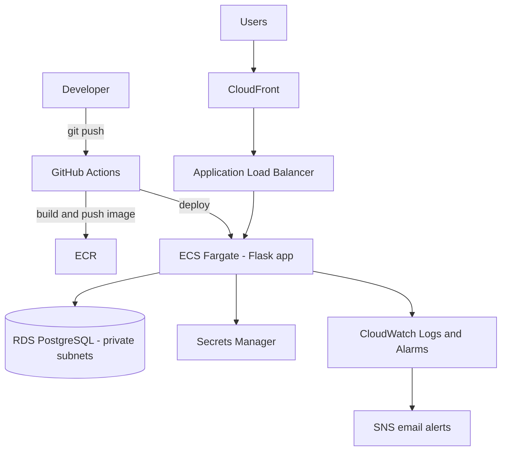
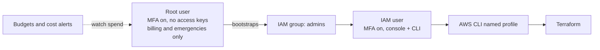
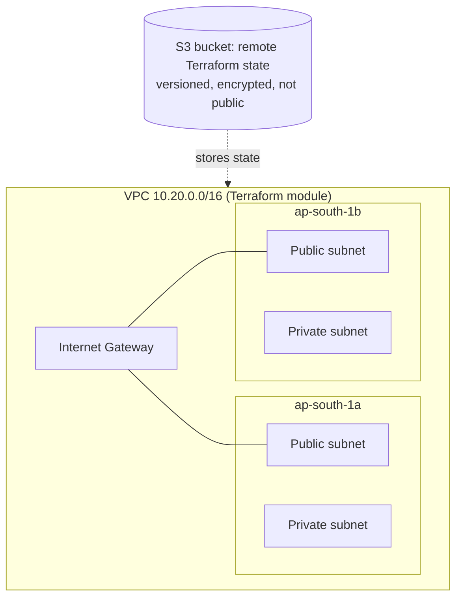
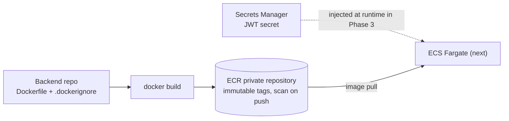

# CloudShip: RP Nutrition on AWS

> Taking a real Flask + PostgreSQL e-commerce app from a simple PaaS deployment to a production-style AWS platform, built end to end with Infrastructure as Code, CI/CD, secrets management and monitoring.


## Why this project

The application (RP Nutrition: Flask, SQLAlchemy, PostgreSQL, JWT auth) already runs on Render. This project rebuilds its hosting the way a real team would on AWS, so every important cloud service gets used for an actual reason, not as a tutorial exercise.

**Goals**
- Provision everything as code (Terraform), reproducible with one command
- Deploy automatically on every `git push` (GitHub Actions, no long-lived keys)
- Keep secrets out of code (Secrets Manager)
- Follow least privilege (IAM) and keep costs under control
- Monitor and alert (CloudWatch, SNS)

## Roadmap

| Phase | Scope | Status |
|---|---|---|
| 0 | Account security, billing guardrails, IAM user, CLI access | Done |
| 1 | Terraform base: remote state (S3), reusable VPC module | Done |
| 2 | Secrets Manager, ECR, Docker image for the Flask app | Done |
| 3 | ECS Fargate service behind an Application Load Balancer | Next |
| 4 | RDS PostgreSQL in private subnets, app connected to it | Planned |
| 5 | CI/CD with GitHub Actions (OIDC to AWS) | Planned |
| 6 | S3 + CloudFront, Route 53 and ACM (custom domain, HTTPS) | Planned |
| 7 | CloudWatch dashboards and alarms, SNS alerts, IAM least-privilege hardening | Planned |
| 8 | Demo video, final documentation, cost summary, teardown | Planned |

## Target architecture (planned)



## AWS services and why each is used

| Service | Purpose in this project |
|---|---|
| VPC | Isolated network with public and private subnets |
| IAM | Least-privilege access for people, pipelines and services |
| S3 | Terraform remote state and static assets |
| ECR | Private storage for Docker images |
| ECS Fargate | Run the Flask container without managing servers |
| ALB | Distribute traffic and run health checks |
| RDS (PostgreSQL) | Managed database in private subnets |
| Secrets Manager | Store DB password, JWT secret and API keys |
| CloudFront | CDN and HTTPS in front of the app |
| Route 53 and ACM | Custom domain and free TLS certificate |
| CloudWatch | Logs, dashboards, alarms |
| SNS | Email notifications for alarms |

## Phase 0: Foundation (done)

Before creating any infrastructure, the account was secured and cost-protected.



**What was done**
- Root account protected with MFA, no root access keys, alternate contacts set
- Monthly cost budget, zero-spend alert, Free Tier usage alerts and cost anomaly detection
- IAM password policy, an `admins` group, and a named IAM user with MFA (permissions granted via the group, not directly to the user)
- Access key created for the CLI and stored in a named profile, never in the repository
- Verified: console login as the IAM user with MFA, and `aws sts get-caller-identity` returns the IAM user

**What was learned**
- Why root is not used for daily work, and how MFA protects the account
- Users, groups, roles and policies, and why permissions go to groups
- Why budgets alert but do not stop spending, so resources are destroyed after each session

**Known trade-off:** the admin group currently uses a broad managed policy for learning speed. It will be replaced with scoped, least-privilege policies in Phase 7.

## Phase 1: Terraform base (done)

Everything from here on is created from code, not from console clicks.



**What was done**
- Bootstrapped an S3 bucket for remote Terraform state (versioning on, encryption on, public access blocked, protected from accidental destroy)
- Wrote a reusable VPC module: VPC, Internet Gateway, 2 public and 2 private subnets across 2 AZs, separate public and private route tables
- Created a `dev` environment that calls the module and stores its state in S3 with state locking
- Verified the full lifecycle: `apply` (12 resources), `destroy`, and `apply` again

**What was learned**
- The Terraform loop: `init`, `validate`, `plan`, `apply`, `destroy`
- Why state lives in a remote backend and what locking prevents
- Modules (reusable recipe) versus environments (where the recipe is used)
- Tagging every resource through provider `default_tags` for cost tracking

**Cost:** about zero. No NAT Gateway yet; it is added later and only during work sessions.

## Phase 2: Container image and secrets (done)

The Flask backend is packaged as a container image and stored in a private registry. Secrets live in Secrets Manager, never in the image or the code.



**What was done**
- Created an ECR repository with Terraform: immutable tags, scan on push, AES256 encryption, and a lifecycle policy that keeps only recent images
- Created a Secrets Manager secret as an empty container with Terraform; the value was set separately through the CLI so it never appears in code, Git or Terraform state
- Wrote a Dockerfile (python 3.12 slim base, non-root user, gunicorn) and a `.dockerignore` that keeps `.env`, `venv` and `.git` out of the image
- Built the image, checked its contents (no secrets, no virtualenv), pushed tag `v1` to ECR
- Read the ECR scan result: 3 HIGH findings, all in base-image OS libraries (glibc, zlib); the pinned application dependencies had no HIGH findings

**What was learned**
- `.gitignore` and `.dockerignore` are separate; Docker does not read `.gitignore`
- Why secrets must never be baked into an image (they stay in layer history even if deleted)
- Immutable tags: a pushed tag cannot be overwritten, so fixes ship as a new version
- Newer Docker pushes extra metadata entries per image, which counts against a "keep last N" lifecycle rule
- A vulnerability scan reports base-image packages too; the fix is usually a rebuilt base image, not an application change

## Repository structure

```
rp-nutrition-cloudship/
├── bootstrap/     # remote state bucket (created first, uses local state)
├── modules/       # reusable Terraform modules (vpc, ...)
└── envs/
    └── dev/       # actual deployment that consumes the modules
```

## Cost control

- Hourly-billed resources (NAT Gateway, ALB, RDS, Fargate) exist only during work sessions
- `terraform destroy` after every session, then a billing check
- Budget alerts and anomaly detection enabled from day one
- Always-on foundation (IAM, state bucket, VPC without NAT) costs almost nothing

## Security notes

- No credentials, state files or `.tfvars` are committed (see `.gitignore`)
- Account identifiers are intentionally omitted from this documentation

## Progress log

| Date | Update |
|---|---|
| Phase 0 | Account secured, billing guardrails and IAM access set up |
| Phase 1 | Remote state bucket and reusable VPC module built with Terraform; destroy and re-apply verified |
| Phase 2 | ECR repository and Secrets Manager secret via Terraform; Flask app containerized, scanned and pushed to ECR |
